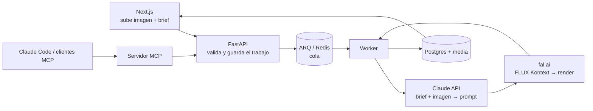

# Mantis Render

Pipeline de renders arquitectónicos con IA. El usuario sube una vista de su modelo (una exportación o captura de SketchUp, un boceto o una foto), escribe lo que quiere ver ("cocina moderna, madera clara, luz de tarde") y recibe un render fotorrealista que conserva la geometría y el encuadre del original.



## Cómo funciona

| Pieza | Qué hace |
|---|---|
| **Next.js** ([frontend/](frontend/)) | Subida de la imagen y el brief. Muestra cada trabajo con su estado en vivo (consulta la API cada 2 s mientras hay algo en curso), la referencia junto al render y el prompt que escribió Claude. |
| **FastAPI** ([backend/app/main.py](backend/app/main.py)) | Valida tipo y tamaño de la imagen, guarda el trabajo en Postgres como `queued`, lo encola y responde enseguida con `201`. |
| **ARQ** ([backend/app/worker.py](backend/app/worker.py)) | Un render tarda de segundos a minutos, así que lo procesa un worker aparte. Distingue errores **transitorios** (red, timeouts, 5xx), que se reintentan con espera creciente hasta 3 veces, de errores **permanentes** (clave inválida, imagen rechazada), que fallan al momento. |
| **Claude API** ([backend/app/prompting.py](backend/app/prompting.py)) | Mira la imagen de referencia y convierte el brief informal (a menudo en español) en una instrucción precisa en inglés para el modelo de imagen: qué conservar (geometría, cámara), qué materiales y luz aplicar a qué superficies, y qué completar con criterio. Devuelve JSON con esquema garantizado (structured outputs) y una nota para el cliente en su idioma. |
| **fal.ai** ([backend/app/rendering.py](backend/app/rendering.py)) | Recibe la imagen y el prompt de Claude y genera el render con FLUX Kontext (modelo de edición de imagen, configurable con `FAL_MODEL`). El resultado se descarga y se guarda, porque las URLs de fal caducan. |
| **Servidor MCP** ([backend/app/mcp_server.py](backend/app/mcp_server.py)) | Expone el pipeline como herramientas (`create_render`, `get_render`, `list_renders`) para que Claude pueda encargar y revisar renders desde Claude Code u otro cliente MCP. Llama a la misma API, así que pasa por la misma validación y cola. |

Algunas decisiones:

- **Por qué Claude antes de fal.ai.** Los modelos de imagen responden mucho mejor a instrucciones concretas que a briefs de cuatro palabras. Claude ve la imagen, así que puede referirse a superficies reales ("la encimera de la isla") y dejar claro que el espacio se reestiliza, no se rediseña.
- **Reintentos baratos.** Si fal.ai falla después de que Claude ya escribió el prompt, el reintento reutiliza ese prompt y solo repite el paso que falló.
- **El estado vive en Postgres, no en la cola.** La web y el servidor MCP leen el progreso de la base de datos; Redis solo transporta trabajos.

## Puesta en marcha

Requisitos: Docker. Claves de la [Claude API](https://platform.claude.com) y de [fal.ai](https://fal.ai/dashboard/keys).

```bash
cp .env.example .env      # rellena ANTHROPIC_API_KEY y FAL_KEY
docker compose up --build
```

- Web: http://localhost:3000
- API (docs interactivas): http://localhost:8000/docs
- MCP: http://localhost:8001/mcp

Sin claves todo arranca igual; los trabajos fallan con un mensaje que indica qué clave falta.

### Conectar Claude por MCP

```bash
claude mcp add --transport http mantis-render http://localhost:8001/mcp
```

Después, en Claude Code: *"Renderiza inbox/salon.png como un salón nórdico con luz de mañana y avísame cuando esté."* Las imágenes locales se dejan en la carpeta [inbox/](inbox/); también acepta una URL pública.

### Desarrollo sin Docker para la web

```bash
cd frontend
npm install
npm run dev               # usa NEXT_PUBLIC_API_URL, por defecto http://localhost:8000
```

## API

| Método | Ruta | Descripción |
|---|---|---|
| `POST` | `/renders` | `multipart/form-data` con `image` (JPG/PNG/WebP, máx. 5 MB) y `brief`. Devuelve el trabajo en estado `queued`. |
| `GET` | `/renders` | Últimos trabajos (`?limit=20`). |
| `GET` | `/renders/{id}` | Estado (`queued`, `processing`, `done`, `failed`), prompt de Claude, nota, error y `result_url`. |
| `GET` | `/media/{archivo}` | Imágenes subidas y renders. |

## Configuración

| Variable | Por defecto | |
|---|---|---|
| `ANTHROPIC_API_KEY` | | Obligatoria para el paso de Claude. |
| `FAL_KEY` | | Obligatoria para el paso de fal.ai. |
| `CLAUDE_MODEL` | `claude-opus-5-5` | |
| `FAL_MODEL` | `fal-ai/flux-pro/kontext` | Cualquier endpoint de fal que acepte `prompt` + `image_url`. |
| `RENDER_MAX_TRIES` | `3` | Intentos por trabajo ante errores transitorios. |
| `FAL_TIMEOUT_S` | `300` | |

## Próximos pasos

- Migraciones con Alembic (ahora las tablas se crean al arrancar).
- Almacenamiento en S3 o similar en lugar de un volumen local.
- Webhooks de fal.ai en lugar de esperar la respuesta en el worker.
- Autenticación y un espacio por usuario.
- Varias variantes por brief y elegir la mejor.
