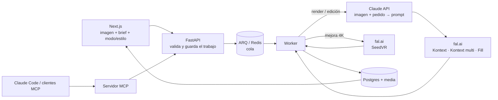

# Mantis Render

Pipeline de renders arquitectónicos con IA. El usuario sube una vista de su modelo (una exportación o captura de SketchUp, un boceto o una foto de obra gris), escribe lo que quiere ver ("cocina moderna, madera clara, luz de tarde") y recibe de 1 a 4 versiones fotorrealistas que conservan la geometría y el encuadre del original. Después puede cambiar una cosa ("cambia solo el piso por porcelanato gris"), con o sin pintar la zona, y sacar cualquier versión en 4K.



Hay tres tipos de trabajo y todos pasan por la misma cola, los mismos reintentos y los mismos estados:

| Tipo | Entrada | Pasos |
|---|---|---|
| `render` | Imagen + brief, modo (interior, exterior, paisajismo, obra gris, mejorar render), estilo opcional, 1–4 versiones, imagen de referencia opcional | Claude escribe el prompt → FLUX Kontext (o Kontext multi si hay referencia de estilo) |
| `edit` | Una versión de un trabajo terminado + el cambio pedido, máscara opcional | Claude escribe la instrucción → Kontext (sin máscara) o FLUX Fill (con máscara) |
| `upscale` | Una versión de un trabajo terminado | SeedVR a 2160p, sin Claude |

Las ediciones y mejoras guardan su trabajo de origen (`parent_id`) y el render original (`root_id`), así que la web las muestra agrupadas bajo cada render y se pueden encadenar (editar una edición).

## Cómo funciona

| Pieza | Qué hace |
|---|---|
| **Next.js** ([frontend/](frontend/)) | Landing en `/` y estudio en `/estudio`: herramientas a la izquierda, ajustes con estilos y plantillas en imágenes ([catalog.ts](frontend/lib/catalog.ts)) y un lienzo con comparador antes/después, versiones y cambios. Muestra el estado en vivo (consulta la API cada 2 s mientras hay algo en curso). Para editar una zona, el usuario la pinta sobre la imagen ([MaskCanvas](frontend/components/MaskCanvas.tsx)) y se envía como máscara PNG del mismo tamaño. Las fotos pesadas del celular se reducen en el navegador antes de subirlas. Los créditos de las imágenes están en [public/img/CREDITS.md](frontend/public/img/CREDITS.md). |
| **FastAPI** ([backend/app/main.py](backend/app/main.py)) | Valida tipo y tamaño de la imagen, guarda el trabajo en Postgres como `queued`, lo encola y responde enseguida con `201`. |
| **ARQ** ([backend/app/worker.py](backend/app/worker.py)) | Un render tarda de segundos a minutos, así que lo procesa un worker aparte. Distingue errores **transitorios** (red, timeouts, 5xx), que se reintentan con espera creciente hasta 3 veces, de errores **permanentes** (clave inválida, imagen rechazada), que fallan al momento. |
| **Claude API** ([backend/app/prompting.py](backend/app/prompting.py)) | Mira la imagen y convierte el pedido informal (a menudo en español) en una instrucción precisa en inglés para el modelo de imagen. En un render: qué conservar (geometría, cámara), qué materiales y luz aplicar a qué superficies según el modo y el estilo ([presets.py](backend/app/presets.py)), y cómo usar la imagen de referencia sin copiar su distribución. En una edición: qué cambiar exactamente y que todo lo demás quede igual, o qué debe aparecer dentro de la zona pintada. Devuelve JSON con esquema garantizado (structured outputs) y una nota para el cliente en su idioma. |
| **fal.ai** ([backend/app/rendering.py](backend/app/rendering.py)) | FLUX Kontext para renders y ediciones con texto, Kontext multi cuando hay imagen de referencia, FLUX Fill para ediciones con máscara y SeedVR para la mejora a 4K. Los resultados se descargan y se guardan, porque las URLs de fal caducan. |
| **Servidor MCP** ([backend/app/mcp_server.py](backend/app/mcp_server.py)) | Expone el pipeline como herramientas (`list_presets`, `create_render`, `edit_render`, `upscale_render`, `get_render`, `list_renders`) para que Claude pueda encargar, corregir y revisar renders desde Claude Code u otro cliente MCP. Llama a la misma API, así que pasa por la misma validación y cola. |

Algunas decisiones:

- **Por qué Claude antes de fal.ai.** Los modelos de imagen responden mucho mejor a instrucciones concretas que a briefs de cuatro palabras. Claude ve la imagen, así que puede referirse a superficies reales ("la encimera de la isla") y dejar claro que el espacio se reestiliza, no se rediseña.
- **Reintentos baratos.** Si fal.ai falla después de que Claude ya escribió el prompt, el reintento reutiliza ese prompt y solo repite el paso que falló.
- **El estado vive en Postgres, no en la cola.** La web y el servidor MCP leen el progreso de la base de datos; Redis solo transporta trabajos.
- **Cada feature es un tipo de trabajo, no un pipeline nuevo.** Editar o mejorar crea un trabajo hijo que reutiliza la cola, los reintentos y los estados. La versión de origen es la entrada del hijo, sin copiar archivos.
- **Editar con texto antes que con pincel.** FLUX Kontext ya cambia una sola cosa a partir de una instrucción, así que la máscara es opcional y solo hace falta cuando se quiere precisión.

## Puesta en marcha

Requisitos: Docker. Claves de la [Claude API](https://platform.claude.com) y de [fal.ai](https://fal.ai/dashboard/keys).

```bash
cp .env.example .env      # rellena ANTHROPIC_API_KEY y FAL_KEY
docker compose up --build
```

- Web: http://localhost:3000
- API (docs interactivas): http://localhost:8000/docs
- MCP: http://localhost:8001/mcp

Sin claves todo arranca igual; los trabajos fallan con un mensaje que indica qué clave falta.

### Conectar Claude por MCP

```bash
claude mcp add --transport http mantis-render http://localhost:8001/mcp
```

Después, en Claude Code: *"Renderiza inbox/salon.png como un salón nórdico con luz de mañana, haz 3 versiones y saca la mejor en 4K."* Las imágenes locales se dejan en la carpeta [inbox/](inbox/); también acepta una URL pública.

### Desarrollo sin Docker para la web

```bash
cd frontend
npm install
npm run dev               # usa NEXT_PUBLIC_API_URL, por defecto http://localhost:8000
```

## API

| Método | Ruta | Descripción |
|---|---|---|
| `GET` | `/presets` | Modos y estilos válidos. |
| `POST` | `/renders` | `multipart/form-data` con `image` (JPG/PNG/WebP, máx. 5 MB), `brief` y opcionales `mode`, `style`, `variants` (1–4) y `reference` (imagen de estilo). Devuelve el trabajo en estado `queued`. |
| `POST` | `/renders/{id}/edit` | `instruction`, `source_index` (versión, desde 0) y `mask` opcional (PNG del tamaño de la imagen, blanco = zona a cambiar). Crea un trabajo `edit`. |
| `POST` | `/renders/{id}/upscale` | `source_index`. Crea un trabajo `upscale` a 4K. |
| `GET` | `/renders` | Últimos renders originales (`?limit=20`), cada uno con sus ediciones y mejoras en `derived`. |
| `GET` | `/renders/{id}` | Estado (`queued`, `processing`, `done`, `failed`), prompt de Claude, nota, error, `result_urls` y `derived`. |
| `GET` | `/media/{archivo}` | Imágenes subidas y resultados. |

## Configuración

| Variable | Por defecto | |
|---|---|---|
| `ANTHROPIC_API_KEY` | | Obligatoria para el paso de Claude. |
| `FAL_KEY` | | Obligatoria para el paso de fal.ai. |
| `CLAUDE_MODEL` | `claude-opus-5-5` | |
| `FAL_MODEL` | `fal-ai/flux-pro/kontext` | Renders y ediciones con texto. |
| `FAL_MULTI_MODEL` | `fal-ai/flux-pro/kontext/multi` | Renders con imagen de referencia. |
| `FAL_FILL_MODEL` | `fal-ai/flux-pro/v1/fill` | Ediciones con máscara. |
| `FAL_UPSCALE_MODEL` | `fal-ai/seedvr/upscale/image` | Mejora a 4K. |
| `RENDER_MAX_TRIES` | `3` | Intentos por trabajo ante errores transitorios. |
| `FAL_TIMEOUT_S` | `300` | |

## Próximos pasos

- Migraciones con Alembic (ahora las tablas se crean al arrancar; un cambio de esquema exige recrear la base de desarrollo).
- Almacenamiento en S3 o similar en lugar de un volumen local.
- Webhooks de fal.ai en lugar de esperar la respuesta en el worker.
- Autenticación, un espacio por usuario y créditos por render.
- Plugin de SketchUp y video a partir del render.
